<!-- ===================== HEADER ===================== -->

  

  

  
  
  
  
  

---

## About Me

I'm a **Computer Engineer** (Sakarya University) specializing in **computer vision and deep learning**.
I build camera-based **defect detection systems for industrial quality control** and deploy them on
**NVIDIA Jetson edge devices**, taking models from dataset preparation to real-time inference on the production line.

- 🔭 **Currently:** AI / Computer Vision Engineer, working on industrial visual inspection
- 🧠 **Focus:** Image classification, object detection & segmentation, model optimization for edge
- ⚡ **Interested in:** Edge AI, robotics, MLOps and end-to-end AI products
- 📫 **Reach me:** [bessemhuseyde@gmail.com](mailto:bessemhuseyde@gmail.com)

---

## What I Work On

| Area | Details |
|---|---|
| **Visual Inspection** | Defect detection for food, chemical and steel-pipe production lines |
| **Model Development** | YOLO-based classification / detection / segmentation, CNN backbones (ConvNeXt, EfficientNet, MobileNet) |
| **Edge Deployment** | NVIDIA Jetson, DeepStream, CUDA, ONNX, INT8 quantization |
| **Data Pipelines** | Dataset preparation, preprocessing, deduplication, augmentation |
| **Tooling** | Desktop tools & dashboards for monitoring inspection results |

---

## Featured Projects

### 🚗 [Smart Parking System – License Plate & Vehicle Type Recognition](https://github.com/BessemHuseydi/Otopark-Sistemi-Plaka-ve-Arac-Tipi-Tanima-)
End-to-end parking management from video: a **custom-trained YOLOv8** model detects license plates, **Tesseract OCR** reads them,
and a second YOLOv8 model classifies the vehicle type. Entries and exits are logged in a **PyQt5** interface and the parking fee is
calculated automatically.

### 📷 [QR Code & Video Processing Application](https://github.com/BessemHuseydi/QR-Code-and-Video-Processing-Application)
Real-time QR code detection and logging running **in parallel** with segmented video recording. Each frame is stamped with
time and location data, and recordings can be replayed in order. Developed for a UAV mission scenario.

### ⚡ [DeepStream-YOLO](https://github.com/BessemHuseydi/DeepStream-Yolo) (fork)
NVIDIA DeepStream SDK implementation for YOLO models — used for running real-time YOLO inference pipelines on Jetson devices.

### 💈 [Barber Shop Management – Web Application](https://github.com/BessemHuseydi/berberSalonu)
A .NET web application for a barber shop, built with an **N-tier architecture** (Entity, Data Access, Business and Web layers).

<b>More repositories</b>

 

- [**PYTHON-EXAMPLES**](https://github.com/BessemHuseydi/PYTHON-EXAMPLES) — Algorithms and code examples in Python
- [**C-plus-plus-examples**](https://github.com/BessemHuseydi/C-plus-plus-examples) — Core C++ examples
- [**All repositories →**](https://github.com/BessemHuseydi?tab=repositories)

---

## Tech Stack

**Languages**

**AI / Machine Learning**

**Edge, Desktop & Tools**

---

## GitHub Stats

  
  

  

  

  

